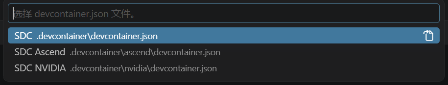

# SDC

## 1. 开发环境

先选择开发位置。本地和云端共用 Dockerfile、`pyproject.toml` 和 `uv.lock`。

| 方式 | Docker 安装位置 | VS Code 打开的仓库 |
| --- | --- | --- |
| [本地开发](#本地开发) | Windows 或本机 WSL | 本机仓库 |
| [云端开发](#云端开发) | 云服务器 | 通过 Remote-SSH 打开的服务器仓库 |

### 本地开发

VS Code 安装 **Dev Containers** 和 **Container Tools** 扩展，再选择下面一种本地方式。首次进入容器会从 `.env.example` 创建 `.env`；使用 Codex 时再填写个人 `OPENAI_API_KEY`。

#### WSL

1. 在管理员 PowerShell 执行 `wsl --install -d Ubuntu-24.04`，按提示重启并完成 Ubuntu 用户初始化。
2. 在 PowerShell 执行 `wsl -d Ubuntu-24.04` 进入 Ubuntu，**在 Ubuntu 自己的文件系统里克隆仓库**：

   ```bash
   git clone https://github.com/meiyou666/SDC.git ~/SDC
   cd ~/SDC
   ```

   不要用 `/mnt/c/...` 下的 Windows 目录。跨文件系统访问很慢，依赖安装、数据分词和实验输出都会受影响。

3. 从清华源安装 Docker Engine 和 Compose：

   ```bash
   bash environment/docker/install-docker.sh
   ```

4. 执行 `exit` 返回 PowerShell，再执行 `wsl -d Ubuntu-24.04`，使 Docker 用户组设置生效。
5. VS Code 安装 **WSL** 扩展，连接 Ubuntu，打开 `~/SDC` 中的 [`SDC.code-workspace`](SDC.code-workspace)。
6. 执行 **Dev Containers: Reopen in Container**，日常开发选择 **SDC**。首次进入时自动构建镜像并启动容器。

#### Windows

**先克隆仓库。** 在本机 PowerShell 执行，未安装 Git 时先安装 [Git for Windows](https://git-scm.com/downloads/win)。

```powershell
git clone https://github.com/meiyou666/SDC.git
cd SDC
```

1. 下载最新的 [Docker Desktop 安装程序](https://docs.docker.com/desktop/setup/install/windows-install/)。在安装包所在目录打开 PowerShell，使用 Docker VMM 后端安装：

   ```powershell
   Start-Process '.\Docker Desktop Installer.exe' -Wait -ArgumentList 'install','--user','--backend=docker-vmm'
   ```

   命令报错时，先把 Docker Desktop 更新到最新版本再重试。

2. 安装完成后启动 Docker Desktop，重新打开 VS Code 和仓库目录中的 PowerShell。
3. 在 Docker Desktop 的 **Settings** 完成以下设置，然后点击 **Apply & restart**：

   - **General → Virtual Machine Manager**：选择 **Docker VMM**。
   - **Resources**：分配至少 4 GB 内存。
   - **Resources → File sharing**：添加仓库目录。

4. 在 Windows 的 VS Code 中打开 [`SDC.code-workspace`](SDC.code-workspace)，执行 **Dev Containers: Reopen in Container**，日常开发选择 **SDC**。首次进入时自动构建镜像并启动容器。

### 云端开发

**本机 VS Code → SSH 连接云服务器 → 服务器上的 Docker 容器。** Docker 安装、镜像构建和代码运行均在服务器完成。

1. **在本机 VS Code 连接服务器。** 安装 **Remote-SSH**、**Dev Containers** 和 **Container Tools** 扩展。执行 **Remote-SSH: Add New SSH Host...**，输入 `ssh 用户名@服务器地址 -p 端口`；再执行 **Remote-SSH: Connect to Host...**。连接后左下角显示 `SSH: 服务器`。
2. **在这个 SSH 窗口新建终端，克隆服务器上的仓库：**

   ```bash
   git clone https://github.com/meiyou666/SDC.git
   cd SDC
   ```

3. **在同一远端终端初始化环境：**

   ```bash
   bash environment/docker/setup-cloud.sh
   ```

   选择普通开发、NVIDIA 或昇腾。脚本安装 Docker、Compose 和 Buildx，构建所选镜像，并生成服务器专用的 VS Code 入口。NVIDIA 环境会配置 Container Toolkit；昇腾环境会记录所选芯片和设备组。

4. **打开服务器上的 `SDC` 文件夹。** 在生成的 `.env` 中填写个人 `OPENAI_API_KEY`。若脚本提示用户组已更新，先执行 **Remote-SSH: Kill VS Code Server on Host**，再重新连接服务器并打开仓库。
5. **进入远端容器。** 执行 **Dev Containers: Reopen in Container**，选择脚本生成的 **SDC 云端（普通开发 / NVIDIA / Ascend）** 入口。VS Code 使用刚构建的缓存启动容器。左下角变为容器名称后，终端、Python 和 Codex 均在服务器容器中运行。

在新建的容器终端执行 `pwd`，应显示 `/workspace/SDC`。GPU / NPU 环境再执行 `python environment/verify_environment.py --accelerator`。完整操作和脚本参数见[云端开发说明](docs/cloud.md)。

### 选择和切换容器

打开工作区后，按 `Ctrl+Shift+P`，执行 **Dev Containers: Reopen in Container（开发容器：在容器中重新打开）**。基本配置如下；云端初始化后，列表中还会显示脚本生成的 **SDC 云端（…）** 入口。恢复之前的容器窗口时，会继续连接该容器。



| 容器名称 | 用途 | 配置文件 |
| --- | --- | --- |
| **SDC** | 日常开发、调试和单元测试 | [开发配置](.devcontainer/devcontainer.json) |
| **SDC NVIDIA** | NVIDIA GPU 上的训练与实验 | [GPU 配置](.devcontainer/nvidia/devcontainer.json) |
| **SDC Ascend** | 昇腾 NPU 上的训练与实验 | [NPU 配置](.devcontainer/ascend/devcontainer.json) |

本机日常开发选择 **SDC**；完成云端脚本后，选择 **SDC 云端（…）**。

**切换容器**：在当前容器窗口按 `Ctrl+Shift+P`，执行 **Dev Containers: Switch Container（开发容器：切换容器）**，选择另一个配置。窗口左下角可查看当前容器名称。

切换云端硬件环境时，先执行 **Dev Containers: Reopen Folder in SSH**，在服务器终端重新运行 `setup-cloud.sh` 选择环境，再进入生成的云端入口。脚本为各环境保存独立入口。

同一台主机上的容器共用仓库目录，默认按宿主机选择 x86-64 或 ARM64。首次使用需要构建，后续启动复用已有镜像和容器；Dockerfile 或依赖更新后，执行 **Dev Containers: Rebuild Container**。

终端启动脚本 `./dev.sh`（WSL）和 `.\dev.cmd`（Windows）固定启动 **SDC 开发环境**。GPU、NPU 的命令行启动方式见[公共训练任务](docs/training.md)。

### 容器内使用

进入容器后，Python 使用 `/opt/venv/bin/python`，依赖由 `uv sync --locked` 安装。详细设置见[环境说明](environment/README.md)。

Ubuntu 的 Docker 安装包与常规 Python 依赖使用清华源，PyTorch 和 NVIDIA Container Toolkit 使用官方源；基础镜像来自 Docker Hub 和 GHCR。

容器已安装 Node.js、npm 和 Codex CLI，VS Code 自动安装 Python 和 Codex 插件。API 地址已预填为 `https://s2api.top/v1`，个人密钥保存在所在主机的 `.env`。登录失败或离线时容器照常启动。工具和依赖维护见[环境说明](environment/README.md)。

配置入口：[Dockerfile](environment/docker/Dockerfile) · [Compose](compose.yaml) · [Dev Container](.devcontainer/devcontainer.json)。

训练任务统一为 Qwen3-0.6B 的全参数继续预训练。服务器使用 NVIDIA GPU 或昇腾 NPU 容器，共用训练配置和软件版本。启动命令见[公共训练任务](docs/training.md)。

## 2. 项目结构

```text
SDC/
├── environment/
│   ├── docker/
│   │   ├── Dockerfile             # 镜像构建
│   │   ├── codex-default.toml     # Codex 初始配置
│   │   ├── entrypoint.sh          # 容器启动
│   │   ├── install-docker.sh     # Ubuntu / WSL 安装 Docker，使用清华源
│   │   ├── setup-cloud.sh        # 云端初始化与镜像构建
│   │   ├── configure-cloud.py    # 生成服务器专用 VS Code 入口
│   │   ├── setup-codex.sh         # 初始化 Codex 并读取 API 密钥
│   │   └── start-dev.ps1          # Windows 启动辅助
│   ├── baseline.json          # 环境基线
│   └── verify_environment.py  # 环境校验
├── compose.yaml               # 命令行容器入口
├── dev.cmd                    # Windows 启动脚本
├── dev.sh                     # WSL 启动脚本
├── pyproject.toml             # 项目依赖声明
├── uv.lock                    # uv 原生锁文件
├── pytest.ini                 # 测试入口
├── ruff.toml                  # Python 检查配置
├── .python-version            # Python 版本
├── .env.example               # 个人 API 配置模板
├── .env                       # 个人密钥，不提交
├── SDC.code-workspace          # VS Code 工作区入口
├── .vscode/extensions.json     # 推荐扩展
├── .devcontainer/
│   ├── devcontainer.json      # SDC：日常开发
│   ├── nvidia/devcontainer.json  # SDC NVIDIA：GPU 训练
│   ├── ascend/devcontainer.json  # SDC Ascend：NPU 训练
│   └── cloud-*/                 # 脚本生成的云端入口，不提交
├── src/
│   ├── algorithms/            # ABFT 算法
│   ├── evaluation/            # 注入、统计与计时
│   ├── training/              # 公共训练任务
│   └── backends/ascend/        # 昇腾算子实现
├── configs/
│   ├── training/              # 公共训练配置
│   └── evaluation/            # 评测配置
├── docs/
│   ├── project.md             # 项目目标、研究主线与实验口径
│   ├── cloud.md               # VS Code 云端开发步骤
│   ├── training.md            # 公共训练任务
│   ├── images/                # 文档截图
│   ├── papers/                # 论文精读记录
│   └── reproduction/          # 复现与人工比对记录
├── experiments/               # 实验配置与小型摘要
├── scripts/
│   ├── check.sh               # 容器内检查
│   ├── train.sh               # 训练入口
│   └── ci/                    # 环境策略检查
├── tests/                     # 测试
├── data/                      # 本地模型与数据，不提交
├── results/                   # 本地实验输出，不提交
├── archive/                   # 旧实验归档
├── .agent/skills/             # 报告语言风格
├── .github/
│   ├── workflows/             # CI
│   ├── CODEOWNERS             # 公共文件维护人
│   └── CODE_REVIEW.md         # 代码审查规范
└── AGENTS.md                  # Agent 开发规范
```

## 3. 协作流程

所有成员在个人分支开发，通过 PR 合并到 `main`。仓库拥有者使用 `meiyou666/dev`，其他成员使用自己的分支。

以下命令在**宿主机的仓库目录**执行。

通过 VS Code、GitHub Desktop 或 Git 命令行提交。HTTPS 使用凭据管理器或个人访问令牌认证；使用 [SSH](https://docs.github.com/zh/authentication/connecting-to-github-with-ssh) 时，将远端设为 `git@github.com:meiyou666/SDC.git`。

首次提交前，设置与 GitHub 账号一致的身份：

```bash
git config user.name "GitHub 用户名"
git config user.email "GitHub 账号邮箱"
```

`environment/`、`configs/training/`、`.github/`、`compose.yaml`、`pyproject.toml`、`uv.lock` 等公共文件由 `meiyou666` 维护。实验代码放 `src/`、`tests/`，实验配置放 `configs/evaluation/`、`experiments/`。

**开始任务**：切换到自己的分支并同步 `main`。以下以拥有者的分支为例：

```bash
git fetch origin
git switch meiyou666/dev
git pull --ff-only
git merge origin/main
```

首次创建个人分支时，使用 `git switch -c name/task origin/main`，将 `name/task` 换成自己的分支名。

**代码改动在容器内检查**：

```bash
bash scripts/check.sh
```

**回到宿主机提交**：

```bash
git status
git add .
git commit -m "简述改动"
git push -u origin HEAD
```

在 GitHub 网页点击 **Compare & pull request**，简述改动和验证结果。Codex 自动审查；CI 通过且获得一名成员批准后合并。Issue 按需使用。

FZY Try