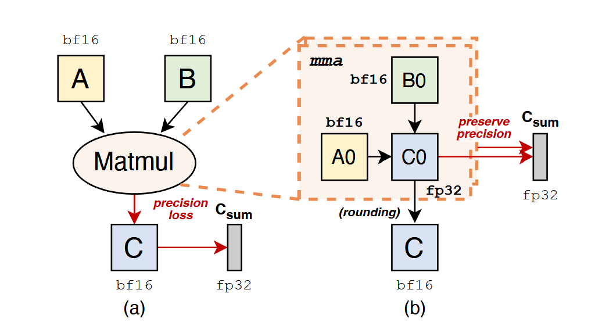

# AEGIS：ABFT 公式与代码复现

## 1.核心创新点

- 架构上：采用两阶段 cSensor-cVerifier

  1. cSensor：与训练同步运行，执行轻量级检测，将检出的可能的错误打包进vTask，便于后续确认
  2. cVerifier：调度到空闲时间段重新执行高度可疑的计算

- 机制上：

  - 混合精度的算法检测

    - FlashAttention 不变量
    - Matmul 校验和**（也即ABFT优化）**

    注：原文为减小开销，采用动态采用策略，而复现时为保证后续各指标分析公平，采样率取100%

  - 自等价性检测（利用自身冗余）

重点关注部分为 Matmul 的行校验、行列校验、FP32 累加器取数接口和历史阈值更新，其他架构/机制不复现。

## 2. ABFT相关公式

### 行校验与行列校验

令有效输入为

$$
A\in\mathbb{R}^{M\times K},\quad B\in\mathbb{R}^{K\times N},\quad C=AB.
$$

“有效输入”指量化码值及其尺度确定的逻辑值。校验应使用实际参与 GEMM 的值，其中fwd、dgrad  采用行校验，wgrad采用行列校验。

记 $\mathbf{1}_N$ 为长度 $N$ 的全 1 列向量。行校验为

$$
s_r^{pred}=A(B\mathbf{1}_N),\qquad s_r^{obs}=C\mathbf{1}_N,\qquad
r_r=s_r^{obs}-s_r^{pred}. \tag{1}
$$

同理，列校验的形式为

$$
s_c^{pred}=(\mathbf{1}_M^T A)B,\qquad
s_c^{obs}=\mathbf{1}_M^TC,\qquad r_c=s_c^{obs}-s_c^{pred}. \tag{2}
$$

用最大绝对残差作为调用级统计量：

$$
\Delta_r=\max_i |r_{r,i}|,\qquad
\Delta_{rc}=\max(\max_i |r_{r,i}|,\max_j |r_{c,j}|). \tag{3}
$$

### FP32 累加器取数



经典 ABFT 从 GEMM 的最终低精度输出取观测校验和，每个输出元素在写出时被截断一次（bf16 尾数仅 7 位，截断误差约 2⁻⁸），求和后这些噪声进入残差并可能淹没故障信号。而矩阵单元执行 GEMM 本是"低精度乘法 + FP32 片上累加"：累加器 C₀ 全程驻留 FP32 寄存器沿 K 维分块乘加，只在写出内存前才截断为低精度。

AEGIS 据此把取数点从低精度输出移到转换前的累加器，观测校验和直接对 C₀ 求行和。本复现中，参考校验和观测归约使用 FP32，残差相减使用 FP64。累加器取数避免了 BF16 输出舍入误差进入残差；具体阈值与检出率由实验比较。

### 自适应阈值

本次先从独立正常校准集得到统计量 $\Delta_1,\ldots,\Delta_n$，得到初始阈值：

$$
\widehat E_0=\max\{\epsilon,\Delta_{(\lceil(1-\alpha)n\rceil)}\}. \tag{7}
$$

其中 $\epsilon>0$ 是配置的数值下限，防止零阈值在乘法更新下始终为零（文中未明确给出数值）。分位数只定义经验校准方法，不保证测试集误报率必然低于 $\alpha$。

令当前阈值为 $\widehat E_t$、连续静默计数为 $q_t$，先按旧阈值判定

$$
a_t=[\Delta_t>\widehat E_t]. \tag{8}
$$

自适应更新采用

$$
(\widehat E_{t+1},q_{t+1})=
\begin{cases}
(\gamma\widehat E_t,0),& a_t=1,\\
(\max(\widehat E_t/\gamma,\widehat E_0),0),& a_t=0,\ q_t+1=W,\\
(\widehat E_t,q_t+1),& \text{其余情况}.
\end{cases} \tag{9}
$$

文中读图可取 $\gamma=2,W=50$。NaN/Inf 信号直接标为可疑，不更新有限历史阈值，这是代码中增加的异常处理。

## 3.实现代码

1. aegis.py (src/algorithms/aegis/aegis.py)：实现 ABFT 检测机制

主要函数：

- prepare(A, B)：在故障注入前生成健康参考校验。行校验为 $A(B\mathbf{1})$，开启列校验时还计算 $(\mathbf{1}^{T}A)B$。
- sense(checksums, observed)：对传入结果进行 FP32 求和，与参考校验相减，得到残差、最大绝对残差及其位置。
- calibrate()：根据正常样本的残差分位数确定初始阈值。这是复现选择。
- Threshold.update()：判断是否超阈值；自适应模式下，报警后上调阈值，连续静默后向基线衰减。也支持保存和恢复状态。

这个文件不执行主矩阵乘法，需要调用方提供被检查的计算结果。

2. reference.py (src/algorithms/aegis/reference.py)：提供 CPU 数学模拟和故障注入

主要函数：

- gemm()：按固定 K 分块计算，输入块转为 FP32，块内矩阵乘法和块间累加均使用 FP32，最后转换为指定输出精度；同时返回 FP32 累加结果和最终输出。主计算不再使用 FP64。
- flip()：对 A、B 或最终累加结果的指定元素执行单比特翻转，也支持零掩码对照。
- bitwise_equal()：逐字节比较故障输出与健康输出，判断输出是否受损。

它用于小规模机制验证，不是实际 Tensor Core/CUTLASS 的计算实现。

3. __main__.py (src/algorithms/aegis/__main__.py)：组织完整对比实验

它读取 YAML 配置，然后依次：

1. 生成正常操作数，执行无故障与配对零掩码计算，检查两者的累加器和输出逐位相同。
2. 分别收集 BF16 输出取数与 FP32 累加器取数的残差，按正常与零掩码样本的经验分位数初始化两组固定阈值。
3. 生成新的操作数，先计算健康输出，再遍历 A、B 和累加器的全部坐标与编码位。每次只翻转一位，各事件从健康数据开始。
4. 每个事件只调用一次 gemm，两种策略共享返回的累加器和输出，分别执行 sense 和阈值判断。
5. 汇总校准集报警率、零掩码报警率和受损事件检出率，保存配置、初始阈值、校准统计和逐事件结果到 run.json。

## 4. FP32 分块小实验（2026-10-23）

### 思路与配置

本轮只改变校验取数点，比较 `output-fixed`（BF16 输出）与 `acc32-fixed`（FP32 累加器）。两组共享 GEMM 模拟、输入、故障事件和最终 BF16 输出。阈值分别校准，注入期间保持固定；不运行自适应策略。

配置为 `experiments/aegis/small.yaml`：随机种子 42，形状按 M、N、K 为 `[8, 8, 16]`，A、B 与最终输出均为 BF16。输入由标准正态随机数转换得到。K 分为 4 块，每块长度 4，采用 FP32 矩阵乘法及累加。只检查行校验，`alpha=0.02`，阈值下限为 `1e-12`。

先生成 32 对独立正常输入。每对执行一次无故障 GEMM 和一次零掩码 GEMM，零掩码目标按 A、B、累加器循环选择，分别覆盖 11、11、10 次。每种策略收集 64 个残差统计量，其中零掩码与正常残差完全配对相同。采用逆经验分布的 0.98 分位数，即排序后第 `ceil(0.98 × 64)=63` 项。本轮该值等于 32 个正常统计量的最大值。

随后从同一随机数生成器继续生成一对新的 A、B，计算一次健康基线。`test_calls: 1` 表示使用这一对新输入执行完整坐标和位遍历。先冻结健康参考校验，再对 A、B 或最终 FP32 累加器注入；累加器注入发生在 BF16 输出转换前。

| 分组 | GEMM 次数 | 两种策略记录数 |
| --- | ---: | ---: |
| 无故障校准 | 32 | 64 |
| 零掩码校准 | 32 | 64 |
| A：128 个元素 × 16 位 | 2,048 | 4,096 |
| B：128 个元素 × 16 位 | 2,048 | 4,096 |
| 累加器：64 个元素 × 32 位 | 2,048 | 4,096 |
| 合计 | 6,208 | 12,416 |

另外有一次新输入的健康基线 GEMM，用于逐位判断故障输出是否变化，不参与校准。因此实际 GEMM 调用共 6,209 次。输出未变和非有限事件均保留。

### 命令与产物

在项目 Docker 容器、仓库根目录运行：

```bash
uv run --locked --extra development pytest -q -p no:cacheprovider tests/abft/test_aegis.py
PYTHONPATH=src uv run --locked --extra development python -m algorithms.aegis \
  --config experiments/aegis/small.yaml
uv run --locked --extra development ruff check --no-cache src/algorithms/aegis tests/abft/test_aegis.py
```

运行环境为 `SDC_RUNTIME=development`、PyTorch `2.9.0+cpu`，执行 CPU 数学模拟。结果保存到 `results/aegis/small-fp32-blocks/run.json`，包含实际配置、源码与锁文件 SHA256、版本、阈值和全部事件。完整结果不提交 Git。再次运行前需在 YAML 中设置新的 `output_dir`，入口不会覆盖已有结果。

### 阈值与检测结果

| 指标 | BF16 输出取数 | FP32 累加器取数 |
| --- | ---: | ---: |
| 初始固定阈值 | 0.05310344696044922 | 0.000003814697265625 |
| 正常校准报警 | 0 / 32 | 0 / 32 |
| 零掩码报警 | 0 / 32 | 0 / 32 |
| BF16 输出受损事件检出 | 4,114 / 5,126（80.2575%） | 5,126 / 5,126（100%） |
| 有限受损事件检出 | 3,958 / 4,970（79.6378%） | 4,970 / 4,970（100%） |
| 非有限输出事件检出 | 156 / 156 | 156 / 156 |

两种策略的最终 BF16 输出相同，因此受损事件及有限受损事件的统计分母完全一致。受损按故障输出与健康输出逐字节不同定义。正常组参与了阈值校准，其 0/32 是校准集报警结果，不是独立测试集误报率。

按注入目标分解：

| 目标 | 注入事件 | BF16 输出受损 | 非有限输出 | BF16 输出取数检出 / 受损 | FP32 累加器取数检出 / 受损 |
| --- | ---: | ---: | ---: | ---: | ---: |
| A | 2,048 | 2,015 | 70 | 1,547 / 2,015 | 2,015 / 2,015 |
| B | 2,048 | 2,023 | 75 | 1,699 / 2,023 | 2,023 / 2,023 |
| 累加器 | 2,048 | 1,088 | 11 | 868 / 1,088 | 1,088 / 1,088 |

其余 1,018 个注入事件未改变最终 BF16 输出，其中 A 为 33 个、B 为 25 个、累加器为 960 个。BF16 输出取数均不报警；FP32 累加器取数分别报警 33、25、632 个。这些事件确实执行了故障注入，但扰动未改变 BF16 输出，不计入受损事件检出率，也不当作正常调用误报。

输出取数阈值约为累加器取数的 `1.39 × 10^4` 倍。本轮累加器取数检出了全部 5,126 个输出受损事件，相比输出取数多检出 1,012 个。该结果来自一对新输入的全坐标、全编码位遍历，不代表其他输入上的检出率。

`run.json` 同时保存 Wilson 95% 区间：总受损检出率分别约为 `[79.1453%, 81.3244%]` 和 `[99.9251%, 100%]`；有限受损检出率分别约为 `[78.4956%, 80.7343%]` 和 `[99.9228%, 100%]`。同一输入上的逐位事件存在相关性，这些按二项比例计算的区间不表示跨输入的泛化置信度。

### 结果分析与复现结论

本轮结果符合累加器取数机制的预期，可认为小规模数学验证成功。

- **差距来源。** FP32 累加器取数避免 BF16 输出舍入误差进入残差，使本轮校准阈值降低约 13,921 倍，因此能检出被输出舍入噪声掩盖的故障。阈值比值不等于检测能力普遍提升的倍数。
- **100% 检出率有实际信号余量。** 新输入的健康残差分别为 `0.04543495`（输出取数）和 `1.907349e-6`（累加器取数），均低于各自阈值。对于输出受损且输出、检测统计量均有限的事件，累加器策略的最小残差仍为阈值的 27.25 倍。因此本轮高检出率并非由健康基线本身报警造成，但它只针对输出受损事件，不代表所有注入均被检出。
- **统计仍需补充。** 本轮只有一对注入输入，正常样本又参与了阈值校准，尚不能评价跨输入检出率或独立测试误报率。此外，两种策略各有 23 个事件输出有限、校验统计量非有限，由异常规则直接报警；分析微小故障敏感度时应将这类事件单列。

当前结论是：在本轮 BF16 输入、FP32 分块累加配置下，累加器取数显著降低正常残差，并检出了全部输出受损单比特事件。

